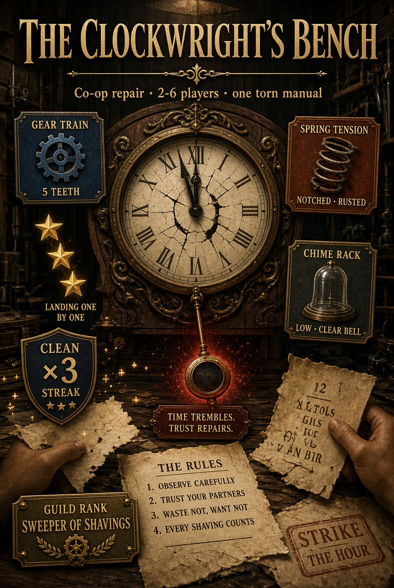

# The Clockwright's Bench

<p align="center"></p>

**Play now:** [the-clockwrights-bench.onrender.com](https://the-clockwrights-bench.onrender.com/). Enter a name and tap **Practice alone** to play with two bot apprentices.

A cooperative repair game for 2–6 apprentices. Three clocks, one torn manual. Each module has one operator, and the page that fixes it is held by someone else, so the team has to talk, read pages out and trust each other before the pendulum stops.

## Run locally

Requires Node.js 18 or newer. No packages to install.

```sh
npm start
```

Open `http://localhost:3002`. Others join with the four-letter workshop code, or tap **Practice alone** to play with two bot apprentices.

## Rules

- Each clock has three modules: Gear Train (colour + teeth), Spring Tension (marking + coil) and Chime Rack (bell + tone). Each shows a symptom plate with six action buttons.
- A random rule map gives each of the 24 symptoms one correct action, shuffled every game. Lines are dealt across the apprentices, and a module's operator never holds that module's pages.
- Clock 1 needs 1 repair per module (120s), clock 2 needs 2 (150s), clock 3 needs 3 (180s).
- A wrong press is a strike and flips a new plate. Three strikes seize the clock.
- Scoring: +40 per repair (credited to the page holder), and on completion +100, +2 per second left, −30 per strike. Clocks earn up to three stars.
- **Silent Bench** mode uses read-outs, "Who has this?" and quick chips. **Talk It Out** hides the notes for groups on a call.
- Practice: you operate every module. Asking a bot costs 3 seconds and answers after 3 seconds.
- **Linked gears** (from clock 2): repairing the Gear Train turns the Spring Tension, and on clock 3 the Spring turns the Chime Rack. The driven module's plate flips (no strike), so any answer found for it is wasted. The team has to agree on a repair order.
- **Team debrief** after every clock: questions asked, average answer time, how many presses were backed by a page versus guessed, plates turned by linked gears, and a Foreman's tip for the next clock. The final screen sums it up.
- **Bot apprentices talk** in practice: they say which pages they hold at each briefing, warn about the linkage, speak up when a plate matches one of their pages, and react to strikes and repairs.

## Included

- Server-validated presses; stale presses after a plate changes are rejected without a strike
- Rule map and other players' pages never leave the server; read-outs only accept your own lines
- Disconnected apprentices' pages and modules are handed round after 15 seconds and rebalanced when they return
- Inline SVG symptom plates with text labels and shape markers, a pendulum timer that slows as time runs low (a plain bar with reduced motion), strike stamps, synthesised sounds
- Awards: Steady Hands, Best Reader, Quick Eyes; keyboard shortcuts 1–6 / A–F
- `/healthz` returns `ok` for uptime monitors
- Gamified layer (`fx.js`): guild ranks from Sweeper of Shavings to Timekeeper Royal, XP and eight guild medals saved on the device, named clock bumpers, module lamps, a clean-repair streak, gear bursts, stars that land one at a time and a shareable result card

Submission details (title, description, cover, link) are in [SUBMISSION.md](SUBMISSION.md).

Room state is held in memory and resets when the server restarts.
